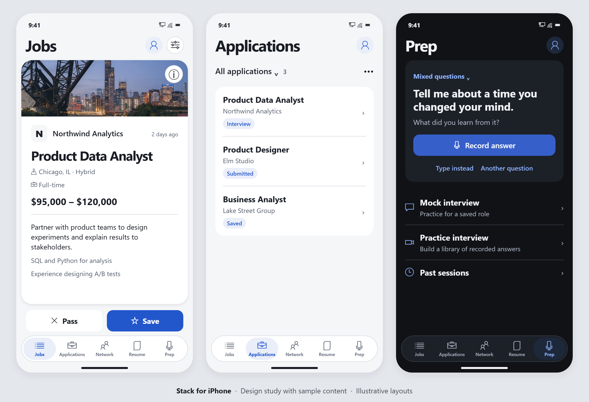

# Stack iPhone redesign

The main problem was finding the next action. A job could be saved by swiping, the Prep topic picker contained two entire interview modes, and Gmail setup came before tracked applications. Long forms also let their exit control scroll out of reach. These costs compounded as someone followed a single job from discovery to an interview.

The implemented direction gives each tab a distinct purpose inside one consistent shell. Jobs leads with the role and a decision. Applications leads with the user's pipeline. Network separates public presence from people. Resume opens on documents. Prep opens on the next question, with interview modes in sight.



*Illustrative layouts with fictional data. This study uses the implemented palette and hierarchy. The Mac build will show native typography, controls and motion.*

## Scope of the audit

The starting point was fetched `origin/main` at `a013e268af503610530bd0599bb51984464f9815`. The final candidate includes the subsequent main revision `8d6649438d859d5fb5b8c6a0fcaf36a55006e035`, including queued LinkedIn reviews and model-switch confirmation. We followed the SwiftUI app's production entry points, presentations, workflow states, notification handlers and Live Activity into their destinations. Each inventory describes what users encounter, the code-level finding and the treatment. Some secondary screens receive their changes through shared components.

| Area | Coverage |
| --- | --- |
| [Access, Jobs, Applications and Profile](discovery.md) | Authentication and admission, onboarding, role and location pickers, job deck and browser, filter panes, application details, Calendar, Gmail, reminders, preparation plan and account settings. |
| [Network, Resume and Agents](workspace.md) | Contacts, discovery catalog, profile drafts, LinkedIn PDF review, document upload and editing, template selection, tailoring, memory bank, approvals, agent tasks and remote browser. |
| [Prep, interviews and recording](practice.md) | Practice home, spoken and typed answers, review and coaching, saved sessions, role-specific interviews, technical exercises, video and audio practice, playback, and Live Activity. |

### App shell and system entry points

| Entry | Audit finding and implementation |
| --- | --- |
| Cold launch and account restoration | The old splash enforced a minimum hold, then waited for a reveal and logo flight. The system launch color now matches the adaptive canvas. The logo and spinner appear during restoration and give way to the actual destination when it is ready. |
| Startup failure | A failed restore has its own readable error and Retry action. It receives the same accessible typography and button treatment as sign-in. |
| Signed-in and new accounts | Onboarding remains restricted to new accounts. All five tab roots share navigation and account access. A visited root stays mounted so switching tabs preserves its working context. |
| Navigation between tabs | One selected capsule, symbol and label mark the destination in every tab, including an empty Resume. The highlight animates independently of a tab's contents. Reduce Motion suppresses its travel. |
| Notifications and app links | Application and contact notices still open their record. Agent notices present the corresponding task. Tab reminders, app links and the Prep Live Activity use the existing tab routing. Cold-launch handoff and account scoping remain in the root and app delegate. |
| Modal and system UI | Standard long sheets pin their dismissal control. Close, Cancel and Back reflect different exits. System authorization, Safari, Files, keyboard, preview, sharing and permission interfaces retain their platform controls. |
| Development-only surfaces | The debug Motion Lab offers production components with fixture data. Launch arguments also expose screen-flow, filter, local-draft and microphone fixtures. The `Loading account` lab entry now shows the actual restoration state. Release builds exclude these review entrances. |

The color values, component dimensions and animation timings are in the [interface guide](../../ios/UI_STYLE.md). The stable labeled tabs and restrained selection feedback follow Apple's guidance on [tab bars](https://developer.apple.com/design/human-interface-guidelines/tab-bars) and [motion](https://developer.apple.com/design/human-interface-guidelines/motion).

## Build this candidate on a Mac

Copy `Stack-iOS-redesign.bundle` to Downloads. From a Mac clone of Stack, fetch the base and open the supplied revision in a separate worktree.

```sh
git fetch origin main
git fetch ~/Downloads/Stack-iOS-redesign.bundle refs/heads/codex/ios-interface-redesign
git worktree add --detach ../Stack-iOS-review FETCH_HEAD
cd ../Stack-iOS-review
bash scripts/ios-phone.sh
```

The existing script generates the project, builds the Debug app, signs it, installs it and opens it on a paired physical iPhone. It defaults to the shared development backend and the existing Stack bundle ID, which replaces that app on the phone. The signing team and backend can be supplied through the script's existing settings. The script requires Xcode and XcodeGen.

## First hands-on review

1. **Follow one job through the app.** From a fresh account, complete or skip onboarding. Read a long listing, open Safari, return, save the job, undo, save again, and tailor a resume. Return through Applications and open interview preparation for that same job. Check that you can identify the next action at each transition.
2. **Stress a long form.** In dark appearance at a large accessibility text size, search for a location with the keyboard open, edit a resume, and dismiss a nested sheet. Verify the selected value, draft, keyboard control and exit remain reachable. Repeat the tab change and disclosure with VoiceOver and Reduce Motion.
3. **Record a real answer.** Pause and resume, interrupt a mock recording, return from the Live Activity, edit the recovered text and request coaching. Review the answer alongside feedback. Check responsiveness during deck gestures, sheet dismissal and microphone updates on the phone.

The per-area inventories include the remaining empty, error, retry, permissions and account-state checks. Swift 6.1.3 parsed all 137 iOS Swift files for an arm64 iOS 17 target with both Debug and Release conditions. The existing repository checker covered 134 files and all nine checker tests passed. The checked foreground/background pairs for secondary text, accent text and primary buttons measured at least 5.76:1 in the sampled appearances. Native compilation, rendering, frame pacing, VoiceOver focus and device interactions are pending.
